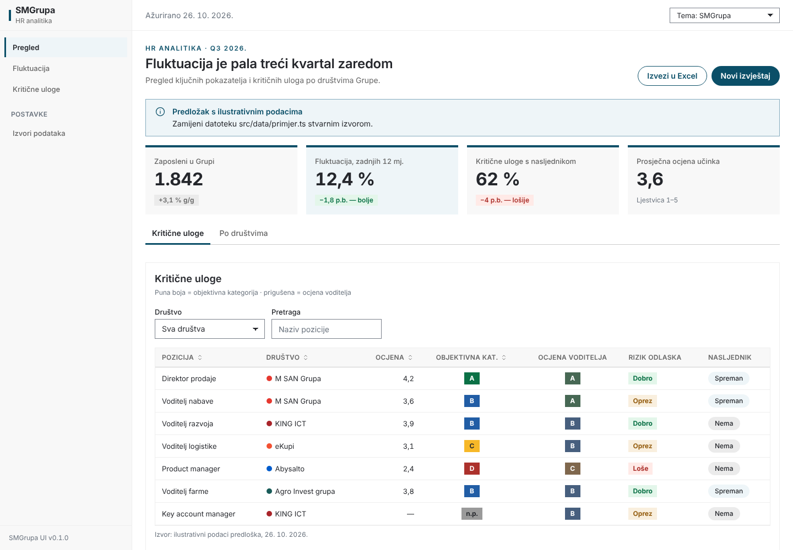

# SMGrupa UI

Grupacijski design system SMGrupe za **interne aplikacije** (HR alati, dashboardi): tokeni, šest tema (SMGrupa + pet društava), React komponente, hrvatsko formatiranje i upute za Claude Code. Isti vizualni jezik kao Design System „SMGrupa” na claude.ai za dokumente i prezentacije.



**Model:** zajednička baza (grafit, bijela, Inter, ravne plohe, pill gumbi) + **jedan akcent** po aplikaciji, biran temom: `smg` (petrolej-plava, zadano), `msan`, `king`, `abysalto`, `aig`, `ekupi`. Semafor A–D, statusne poruke i boje podataka isti su u svim temama.

## Nova aplikacija (Claude Code)

1. Kopiraj mapu `template/` u novi repozitorij (ili reci Claude Codeu: *„Napravi novu aplikaciju iz predloška ldanijel/smgrupa-ui/template”*).
2. `npm install` — paket `@smgrupa/ui` instalira se iz ovog privatnog repozitorija (vidi *Pristup*).
3. `npm run dev`.
4. Predložak već ima `CLAUDE.md` i skill `.claude/skills/smgrupa-ui/`, pa Claude Code u novoj aplikaciji automatski radi po pravilima sustava.

Postojeća aplikacija:

```bash
npm install github:ldanijel/smgrupa-ui#v0.1.0 @fontsource-variable/inter
```

```tsx
// src/main.tsx
import '@fontsource-variable/inter';
import '@smgrupa/ui/styles.css';

// src/App.tsx
import { ThemeProvider, AppShell, PageHeader, KpiCard, DataTable, SemaforBadge, formatPostotak } from '@smgrupa/ui';

<ThemeProvider theme="smg">…</ThemeProvider>
```

Zatim u aplikaciju kopiraj `CLAUDE.app.md` kao `CLAUDE.md` i mapu `.claude/skills/smgrupa-ui/`.

## Pristup za kolege

Repozitorij je privatan. Kolega treba:
1. **Pristup repozitoriju**: GitHub → `ldanijel/smgrupa-ui` → Settings → Collaborators → *Add people* (dovoljna uloga *Read*; *Write* ako će mijenjati sustav).
2. **Git prijavu na svom računalu** (jednom), da `npm install` može dohvatiti paket: `gh auth login` (GitHub CLI) ili SSH ključ dodan na GitHub račun.

## Što sadrži

| | |
|---|---|
| `tokens/tokens.json` | Izvor istine: 71 boja × 6 tema, tipografija (dokumenti, izvještaji, prezentacije, aplikacije), razmaci, sjene, z-index, veličine |
| `dist/styles.css` | Tokeni + stilovi komponenti — jedan uvoz |
| `dist/tailwind.css` | Opcionalno: Tailwind v4 klase iz tokena (`bg-surface-alt`, `text-ink-soft`, `bg-akcent` …) |
| Komponente | `ThemeProvider`, `AppShell`, `NavItem`, `NavSection`, `PageHeader`, `Button`, `Field`, `Input`, `Select`, `Textarea`, `Checkbox`, `Toolbar`, `Card`, `KpiGrid`, `KpiCard`, `DataTable`, `SemaforBadge`, `Alert`, `Tag`, `CompanyTag`, `Tabs`, `EmptyState`, `Icon` |
| Formateri | `formatBroj` (1.842), `formatPostotak` (12,4 %), `formatEUR`, `formatEURKratko` (1,25 mil. EUR), `formatDatum` (26. 10. 2026.), `formatPromjenaPB` (−1,8 p.b.), `formatPromjenaPosto` |
| Grafikoni | `chartColors` (serije, semafor, blijeda), `resolveColor()` za canvas knjižnice |

## Ključna pravila

- Samo tokeni — nikad ručne boje (`npm run check` to provjerava).
- Akcent društva samo za gumbe, navigaciju i linije; **nikad u podacima** (M SAN, KING i eKupi imaju crveni akcent koji bi se čitao kao „loše”). Podaci: `data-*` (SMG petrolej-plava) ili semafor.
- Semafor A–D: zeleno — plavo — žuto — crveno; tri stanja bez plave; druga razina iste kategorije prigušenom inačicom iste boje; uvijek uz slovo ili riječ.
- Statusne poruke (`Alert`) nisu semafor.
- Puna pravila: `.claude/skills/smgrupa-ui/SKILL.md`.

## Razvoj sustava

```bash
npm install          # samo esbuild
npm run build        # tokens.json → dist/tokens.css, tailwind.css, tipovi; CSS; JS
npm run check        # kontrast (41 par × 6 tema) + zabrana ručnih boja
```

`dist/` se commita. Nova verzija: `package.json` → `CHANGELOG.md` → `git tag vX.Y.Z` → `git push --tags`; aplikacije prelaze na novi tag svjesno.

## Plan

- **Tamna tema** — druga os `data-mode="dark"` koja mijenja samo neutralne i status tokene; komponente su već pisane samo na semantičkim tokenima.
- **Tema po korisniku** — `ThemeProvider theme={korisnik.drustvo}` nakon prijave; teme su već spremne.
- **Grafikoni** — omotači za odabranu knjižnicu (npr. Recharts) s `chartColors`.
- **Objava na claude.ai** — `/design-sync` u Claude Codeu da Design System artefakt prati ovaj repo.

Vlasnik: Danijel · v0.1.0 · 26. 10. 2026.
